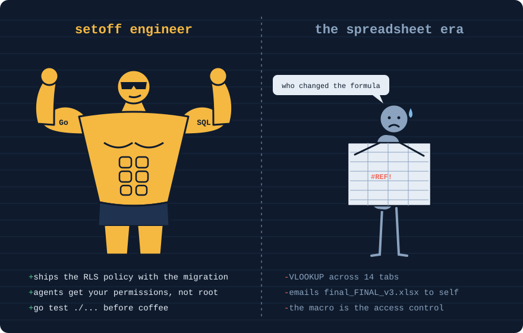

<p align="center">
  
</p>

We build AI agents that do real tax work for accounting firms: they read bank lines, match them to the ledger, prepare returns and post journals. Money and client data are on the line, so the engineering is strict. Debits equal credits, agents follow the same rules as people, and the database enforces both.

## The stack

```yaml
# stack.yaml: what you would touch in your first month
api:      Go, chi, golang-migrate, SQL you can read
workers:  Go, Asynq on Redis
agents:   Go agent loop, Python + FastAPI for model work
models:   Anthropic, OpenAI, Gemini, chosen per task
web:      React 19, TypeScript, Vite
mobile:   Expo + React Native   # Protas in your pocket
data:     PostgreSQL with row-level security, Redis
cloud:    AWS, S3 + CloudFront, Docker
```

## How we build

```go
// The rule every Setoff agent follows before it touches a tool.
func (a *Agent) Call(ctx context.Context, tool Tool, args Args) (Result, error) {
	who := CallerFrom(ctx)           // the person who asked, never a system user
	if !who.Can(tool.Requires) {
		return Denied(tool.Requires) // say which permission is missing; never guess
	}
	return tool.Run(ctx, args)       // the same gate the human path uses
}
```

- **An agent never has more access than the person who asked it.** A prompt injection can only request what that person could already do.
- **Postgres keeps tenants apart.** Row-level security means a forgotten `WHERE` clause returns nothing it shouldn't.
- **Long agent runs take a snapshot of permissions when they start** and stop for approval one step at a time.
- **Guards fail the build** so code review is for design, not for catching the same mistake twice.

## Meanwhile, in the office

<p align="center">
  
</p>

## Work with us

We hire engineers who like Go, Postgres and problems where a rounding error is a bug report from an accountant. Tell us what you've built at [setoff.tax](https://setoff.tax).
