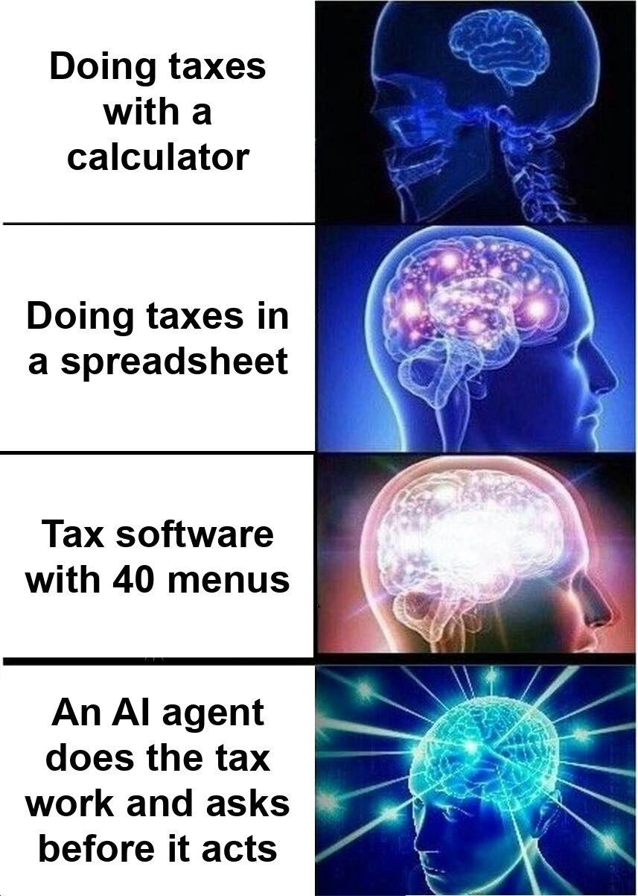

```
                   ____                               .-'''-.             セ
                __/\/\/\__                          .'       '.           ッ
              _/          \_                       /           \          ト
            _/   '   ,   '  \_                     |           |          オ
          _/                  \_                   \           /          フ
       __/                      \__                 '.       .'
    __/                            \__                '-...-'
  ~^~^~^~^~^~^~^~^~^~^~^~^~^~^~^~^~^~^~^~^~^~^~^~^~^~^~^~^~^~^~^~^~^~^~^~^~^~^~^~^

         _____    ______  ______   ____     ______    ______
        / ___/   / ____/ /_  __/  / __ \   / ____/   / ____/
        \__ \   / __/     / /    / / / /  / /_      / /_
       ___/ /  / /___    / /    / /_/ /  / __/     / __/
      /____/  /_____/   /_/     \____/  /_/       /_/

      AI for tax and accounting work                              税務 × 人工知能
```

## 会社 &nbsp;the company

Setoff builds AI for tax and accounting work. Accounting firms run their tax workflow on Setoff: client books, reconciliations, returns and the paperwork in between. Protas, our AI assistant, takes the repetitive work and checks with a person before anything is final.

```
+-- Setoff ----------------------------+   +-- Protas ----------------------------+
| the tax workflow platform            |   | the AI assistant inside Setoff,      |
| for accounting firms                 |   | on the web and on your phone         |
+--------------------------------------+   +--------------------------------------+
```

## 技術 &nbsp;the stack

```
setoff
|-- 脳  ai         Anthropic, OpenAI, Gemini, Python, FastAPI
|-- 骨  backend    Go, Asynq workers on Redis
|-- 顔  web        React 19, TypeScript, Vite
|-- 携  mobile     Expo, React Native
|-- 蔵  data       PostgreSQL with row-level security, Redis
`-- 雲  cloud      AWS, S3, CloudFront, Docker
```

## 遊 &nbsp;the break room

<p align="center">
  
</p>

<p align="center">
  
</p>

## 募集 &nbsp;we're hiring

We hire engineers who want AI to do real work where real money is on the line. Say hello at [setoff.tax](https://setoff.tax).

## 謝辞 &nbsp;credits

The meme formats belong to their creators. Setoff wrote the captions only.

- **Buff Doge vs. Cheems.** Swole Doge was first posted by u/purnya232 on r/dogelore in 2019, and the vs. Cheems format followed in 2020 ([meme.com](https://meme.com/memes/swole-doge-vs-cheems), [Know Your Meme](https://knowyourmeme.com/memes/cheems)). Doge is Kabosu, from the photo her owner Atsuko Sato posted in 2010 ([Wikipedia](https://en.wikipedia.org/wiki/Doge_(meme))). Cheems is Balltze. Template from [Imgflip](https://imgflip.com/memegenerator/247375501/Buff-Doge-vs-Cheems).
- **Expanding Brain.** Also called Galaxy Brain, from early 2017 ([Know Your Meme](https://knowyourmeme.com/memes/galaxy-brain)). Template from [Imgflip](https://imgflip.com/memegenerator/93895088/Expanding-Brain).

```
   ~^~^~^~^~^~^~^~^~^~^~^~^~^~^~^~^~^~^~^~^~^~^~^~^~^~^~^~^~^~^~^~^~^~^~^~^~^~   またね
```
