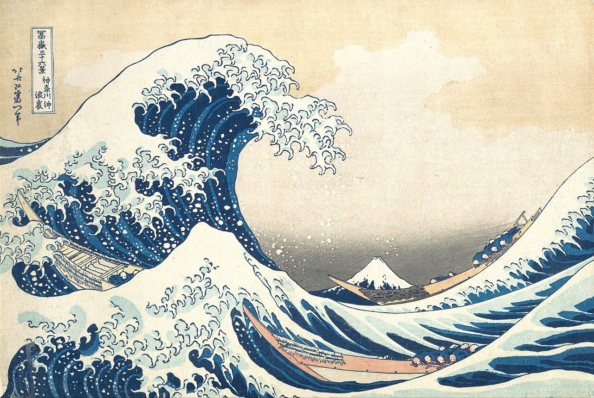
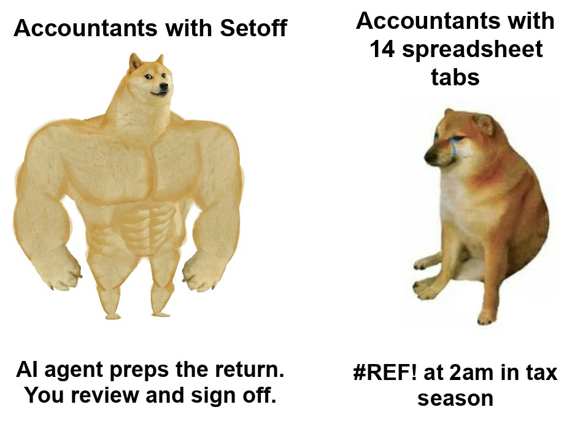

  

  <picture>
    <source media="(prefers-color-scheme: dark)" srcset="assets/brand/setoff-logo-white.svg">
    
  </picture>

AI for tax and accounting work

## The company

Setoff builds AI for tax and accounting work. Accounting firms run their tax workflow on Setoff: client books, reconciliations, returns and the paperwork in between.

- **Setoff**: the tax workflow platform for accounting firms
- **Protas**: the AI assistant inside Setoff, on the web and on your phone

## The stack

  
  
  
  
  
  
  
  
  
  
  
  
  
  

## The break room

  

  

## We're hiring

We hire engineers who want AI to do real work where real money is on the line. Email [hello@setoff.tax](mailto:hello@setoff.tax) with something you've built, or visit [setoff.tax](https://setoff.tax).
